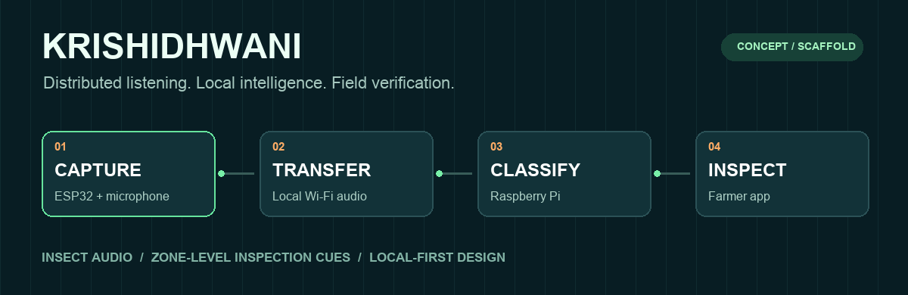
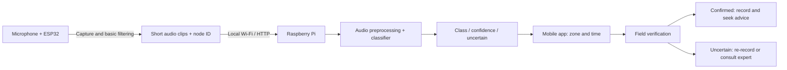

<div align="center">



# KrishiDhwani
### Listen locally. Inspect precisely.

**Distributed insect-audio monitoring for small farms.**

`ESP32 nodes` → `Local Wi-Fi` → `Raspberry Pi intelligence` → `Farmer app`

[Explore the architecture](#how-it-works) · [Get the datasets](#insect-audio-datasets) · [Project structure](#project-structure) · [Start building](#start-building)

</div>

> **Project stage: concept + starter scaffold.** This repository documents the proposed system and contains clearly marked placeholders. It does not yet contain working field firmware, a trained classifier, an integrated app, or measured accuracy. The animated banner illustrates the intended flow; it is not live telemetry.

## The problem

**Insect activity can go unnoticed between field inspections.** Farmers need timely, zone-specific evidence to decide where to inspect.

| Monitoring gap | Why it matters |
| --- | --- |
| Periodic scouting | Activity can occur between visits. |
| Limited zone-level evidence | Farmers may not know where to inspect first. |
| Field noise and species differences | Audio recognition needs local validation before field use. |

## The idea

Place microphone-equipped ESP32 nodes in mapped field zones. Each node captures short clips, performs basic filtering and sends audio over the Raspberry Pi's local Wi-Fi network. The Pi runs the classifier, groups repeated detections and serves results to a farmer's phone on the same network.

**The output is an inspection cue—not a diagnosis of infestation or an automatic treatment instruction.**

## How it works



| Component | Responsibility |
| --- | --- |
| **ESP32 node** | Capture audio, basic filtering, packet metadata and upload retries. No insect classification on the node. |
| **Raspberry Pi** | Local access point, audio intake, bounded work queue, model inference, aggregation and local records. |
| **Farmer app** | Zone status, timestamps, confidence, inspection history and explicit offline/stale states. |

Local use does not require internet. Remote access beyond the field network requires additional connectivity. Wi-Fi coverage, microphone placement and sampling settings must be measured with the actual hardware. Zone IDs identify sensor locations; they do not triangulate individual insects.

## Proposed technology stack

| Layer | Choice |
| --- | --- |
| Nodes | ESP32 + compatible I2S MEMS microphone; ESP-IDF with C/C++ |
| Network | 2.4 GHz local Wi-Fi; HTTP over TCP for clip upload |
| Central computer | Raspberry Pi + Raspberry Pi OS; supported Wi-Fi access-point interface |
| Backend | Python + FastAPI; SQLite for metadata; local files for retained clips |
| Audio processing | NumPy + SciPy + librosa |
| Training | TensorFlow / Keras; compact CNN or DS-CNN candidate |
| Baseline | MFCC features + scikit-learn classifier |
| Pi inference | Compatible TensorFlow Lite / LiteRT runtime, to be validated on the target OS |
| Mobile app | Flutter + Dart, proposed; team implementation pending |

## Insect audio datasets

**Start with a relevant, verified subset—not every species in a dataset.** Insect recordings are not automatically agricultural pest labels. Confirm crop relevance, species identity and whether the microphone can capture the target sound.

### Primary candidate · InsectSet459 v1.1

Public sound recordings of Orthoptera and Cicadidae, with an official train/validation/test split. Review annotation granularity and per-recording licensing before use.

**[Open dataset and download files on Zenodo](https://zenodo.org/records/18554693)** · [Dataset authors' code](https://github.com/mariusfaiss/InsectSet459)

The full archive is large; inspect metadata and choose relevant classes before downloading audio. No dataset is bundled here and nothing downloads automatically.

### Optional research resource · ECOSoundSet

Annotated European Orthoptera and Cicadidae audio. Useful for annotation methods or overlapping species; it does not establish performance on Indian farms.

**[Open ECOSoundSet downloads](https://doi.org/10.5281/zenodo.15043892)** · [Research paper](https://doi.org/10.1038/s41597-026-07150-1)

### Required next step · Local validation

Collect independently verified target-insect recordings and local background negatives such as wind, rain, machinery and non-target insects. These negatives support rejection; they are not an unrelated training benchmark. Keep clips from the same recording/session together when splitting data. See [dataset protocol](datasets/README.md).

## Model and evaluation plan

1. Establish a small, acoustically detectable target list with independent species verification.
2. Compare an MFCC baseline with a compact CNN using suitable time-frequency features.
3. Keep capture and preprocessing consistent between training and Pi inference.
4. Add background rejection and an uncertain outcome; calibrate thresholds on held-out data.
5. Evaluate per-class precision/recall, macro-F1, confusion matrix and field false-alert rate.
6. Measure inference latency, queue delay, packet delivery, storage use and Wi-Fi coverage.

Confidence scores are not infestation probabilities. Repeated detections are not insect counts. No accuracy, yield improvement or pesticide-saving result is claimed yet.

## Project structure

```text
krishidhwani/
├── firmware/esp32/      # Node capture/filter/upload placeholders
├── gateway/            # Pi API skeleton and classifier boundary
├── mobile/             # Flutter UI entry-point placeholder
├── ml/                 # Training/evaluation/export placeholders
├── datasets/           # Download links, metadata template, local storage slots
├── hardware/           # Component roles and wiring checklist
├── configs/            # Example node and gateway configuration
├── docs/               # Architecture, API contract, model card and demo guide
├── examples/           # Clearly labeled synthetic payloads
├── tests/              # Pending integration scenarios
└── tools/              # Dataset-link helper
```

## Start building

Read [implementation status](docs/STATUS.md) first. The folders are intentionally scaffolded.

```bash
# Show dataset links; no dependencies or downloads required
python3 tools/dataset_links.py

# Optional: start the API contract skeleton on your own machine
python3 -m venv .venv
source .venv/bin/activate
python -m pip install -r gateway/requirements.txt
python -m uvicorn gateway.app.main:app --host 127.0.0.1 --port 8000
```

Open `http://127.0.0.1:8000/docs`. Health reports **scaffold**; hardware and inference routes return **501 Not Implemented**, rather than fabricated predictions. The local-only bind is intentional until authentication and upload limits are implemented.

## Build milestones

- [ ] Record and replay clean clips from one ESP32 microphone.
- [ ] Add Pi intake, IDs, acknowledgements, retry and duplicate handling.
- [ ] Validate target species and prepare leakage-safe dataset splits.
- [ ] Train and evaluate baseline + compact model; export for Pi.
- [ ] Connect the app to real local results and inspection feedback.
- [ ] Test multiple nodes, connectivity loss, field noise and false alerts.

## Demo plan

Show a node recording a controlled insect clip, its upload to the Pi and the resulting app state once implemented. Repeat with background/unknown audio and a disconnected node. Label speaker playback as a controlled demonstration; it is not evidence of field detection range. See [demo checklist](docs/DEMO.md).

## Research and documentation

- [Adaptive representations of sound for automatic insect recognition](https://doi.org/10.1371/journal.pcbi.1011541) — representation choices for insect audio.
- [InsectSet459 v1.1](https://doi.org/10.5281/zenodo.18554693) — candidate source recordings and metadata.
- [ECOSoundSet paper](https://doi.org/10.1038/s41597-026-07150-1) — detailed insect annotation methods.
- [ESP-IDF I2S documentation](https://docs.espressif.com/projects/esp-idf/en/stable/esp32/api-reference/peripherals/i2s.html) — microphone interface; consult your chip variant.
- [Raspberry Pi configuration](https://www.raspberrypi.com/documentation/computers/configuration.html) — networking setup.
- [LiteRT documentation](https://ai.google.dev/edge/litert) — inference runtime; verify device compatibility.

---
<div align="center">
<b>Listen → Locate the sensor zone → Inspect → Verify</b><br>
A Build with Bharat 4.0 project concept. Dataset rights remain with their respective creators.
</div>
